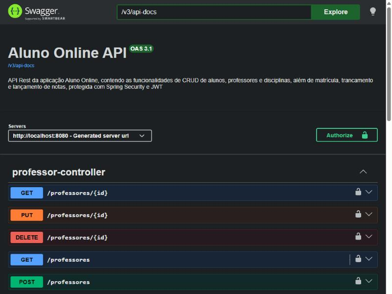
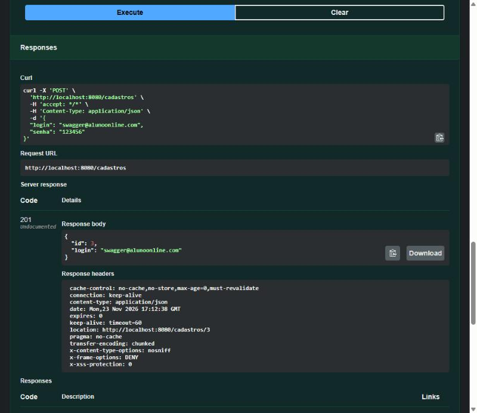
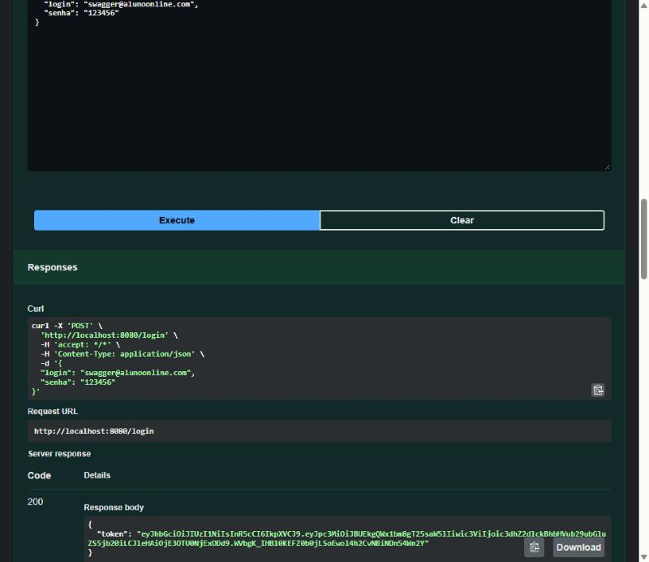
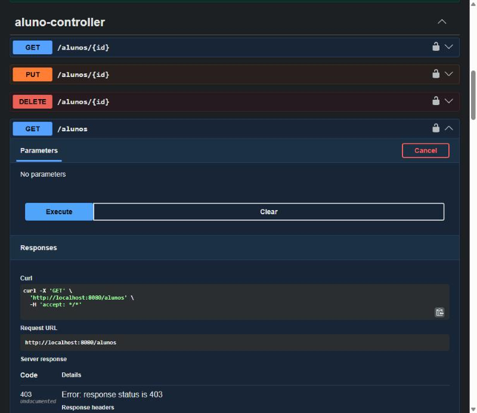
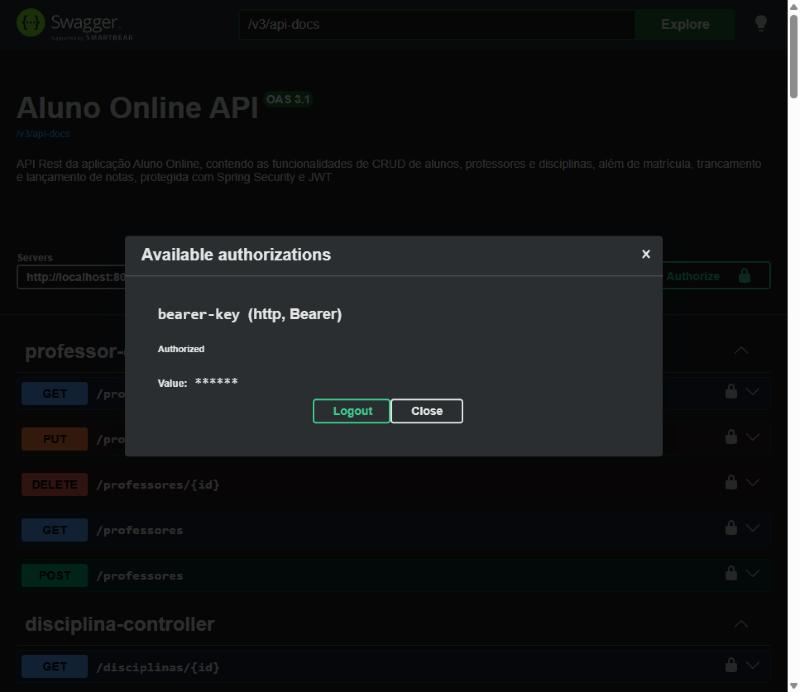
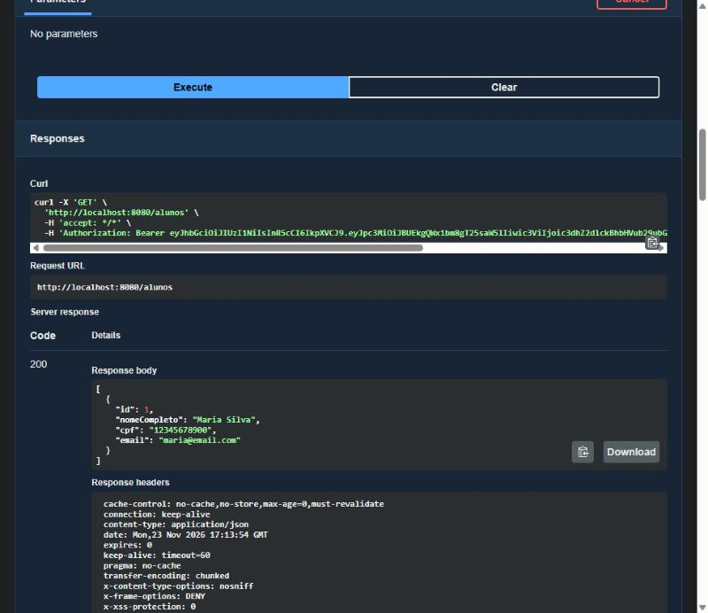
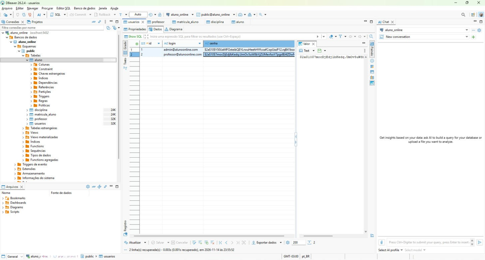
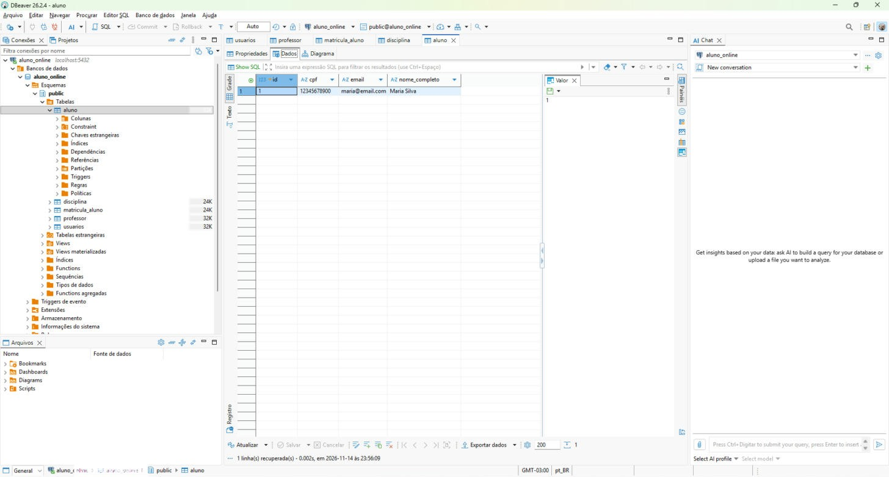

# 🔐 Aluno Online – API REST com Spring Boot e JWT

## 📌 Sobre o Projeto

O **Aluno Online** é uma API REST desenvolvida em Java utilizando Spring Boot, com o objetivo de realizar o gerenciamento de informações acadêmicas, como alunos, professores, disciplinas e matrículas.

Nesta versão, foi implementado um sistema de segurança utilizando **Spring Security e JWT (JSON Web Token)**, permitindo controlar o acesso às funcionalidades da aplicação por meio de autenticação de usuários.

## 🎯 Objetivos e Funcionalidades

Inicialmente, a API permitia que qualquer pessoa acessasse suas rotas e realizasse operações nos dados cadastrados. Com a implementação do sistema de segurança, o acesso passou a ser controlado.

As principais funcionalidades adicionadas foram:

- **Login:** permite que o usuário entre no sistema utilizando login e senha, recebendo um token JWT.
- **Proteção das rotas:** as requisições precisam apresentar um token válido no cabeçalho Authorization.
- **Criptografia de senhas:** utilização do BCrypt para armazenar senhas de forma protegida no banco de dados.
- **Registro de usuários:** criação de novos usuários por meio de uma rota pública.
- **Swagger:** documentação das rotas da API, permitindo visualizar e testar as funcionalidades diretamente pelo navegador.

A aplicação utiliza o modelo **STATELESS**, ou seja, não mantém sessões dos usuários no servidor. A autenticação é realizada através do token enviado em cada requisição.

As funcionalidades anteriores de gerenciamento acadêmico foram preservadas, incluindo cadastro de alunos, professores, disciplinas, matrículas, cálculo de médias e trancamento de matrículas.

---

## 🏗️ Organização da Aplicação

O projeto utiliza a arquitetura em camadas (*Layered Architecture*), separando as responsabilidades de cada parte do sistema.

As principais camadas são:

1. **Model:** contém as entidades que representam os dados armazenados no banco. A entidade Usuario também implementa UserDetails, permitindo sua integração com o Spring Security.
2. **Repository:** responsável pela comunicação com o banco de dados através do Spring Data JPA. Também possui o método findByLogin para localizar usuários.
3. **Service:** concentra as regras de negócio e os processos de autenticação. A classe AutenticacaoService implementa UserDetailsService.
4. **Controller:** recebe as requisições HTTP e disponibiliza os endpoints da API. Foram adicionados os controllers de autenticação e cadastro de usuários.
5. **Infra:** reúne as configurações de segurança, filtros de autenticação, geração de tokens e tratamento de erros.

### 🔑 Processo de autenticação

Quando o usuário realiza o login, o sistema verifica suas informações no banco de dados e compara a senha utilizando BCrypt.

Após a validação, é gerado um token JWT que será utilizado nas próximas requisições.

```text
POST /login
       |
       v
AutenticacaoController
       |
       v
AuthenticationManager
       |
       v
AutenticacaoService
       |
       v
UsuarioRepository
       |
       v
Verificação da senha com BCrypt
       |
       v
TokenService
       |
       v
Retorno do token JWT
```

### 🛡️ Controle de acesso

Nas demais operações, o sistema verifica se o usuário possui um token válido.

```text
Requisição HTTP
       |
       v
SecurityFilter
       |
       v
Leitura do token JWT
       |
       v
Validação do token
       |
       v
Identificação do usuário
       |
       v
Verificação de autenticação
       |
       v
Acesso permitido ou bloqueado
```

As rotas de login e cadastro permanecem públicas. As demais funcionalidades precisam de autenticação.

---

## 📁 Estrutura dos Pacotes

A organização do código está dividida da seguinte maneira:

```text
src/main/java/br/com/alunoonline/api/
│
├── controller/
│   ├── AlunoController
│   ├── ProfessorController
│   ├── DisciplinaController
│   ├── MatriculaAlunoController
│   ├── AutenticacaoController
│   └── UsuarioController
│
├── dtos/
│   ├── AtualizarNotasRequestDTO
│   ├── DadosAutenticacao
│   ├── DadosCadastroUsuario
│   └── DadosDetalhamentoUsuario
│
├── infra/
│   ├── exception/
│   │   └── TratadorDeErros
│   ├── springdoc/
│   │   └── SpringDocConfigurations
│   └── security/
│       ├── SecurityConfigurations
│       ├── SecurityFilter
│       ├── TokenService
│       └── DadosTokenJWT
│
├── model/
│   ├── Aluno
│   ├── Professor
│   ├── Disciplina
│   ├── MatriculaAluno
│   └── Usuario
│
├── repository/
│   ├── AlunoRepository
│   ├── ProfessorRepository
│   ├── DisciplinaRepository
│   ├── MatriculaAlunoRepository
│   └── UsuarioRepository
│
└── service/
    ├── AlunoService
    ├── ProfessorService
    ├── DisciplinaService
    ├── MatriculaAlunoService
    └── AutenticacaoService
```

---

## 🚀 Endpoints Disponíveis

### Rotas públicas

Não precisam de autenticação.

| Método | Endpoint | Descrição |
|---|---|---|
| POST | `/login` | Realiza o login e retorna o token JWT. |
| POST | `/cadastros` | Registra um novo usuário. |

### Rotas protegidas

Precisam de um token JWT válido no cabeçalho:

`Authorization: Bearer <token>`

**Gerenciamento acadêmico:**

| Método | Endpoint | Funcionalidade |
|---|---|---|
| POST | `/alunos` | Cadastrar aluno |
| GET | `/alunos` | Listar alunos |
| PUT | `/alunos` | Atualizar aluno |
| DELETE | `/alunos` | Excluir aluno |
| POST | `/professores` | Cadastrar professor |
| GET | `/professores` | Consultar professores |
| POST | `/disciplinas` | Cadastrar disciplina |
| GET | `/disciplinas` | Consultar disciplinas |

**Matrículas e notas:**

| Método | Endpoint | Funcionalidade |
|---|---|---|
| POST | `/matriculas` | Realizar matrícula |
| PATCH | `/matriculas/atualizar-notas/{id}` | Registrar notas e calcular média |
| PATCH | `/matriculas/trancar/{id}` | Alterar matrícula para trancada |

O sistema também possui operações de atualização e exclusão para os demais cadastros.

Quando uma matrícula recebe as duas notas, a aplicação calcula automaticamente a média e define a situação do aluno como aprovado ou reprovado.

Requisições sem autenticação ou com tokens inválidos e expirados são bloqueadas.

---

## 💻 Tecnologias e Ferramentas

As seguintes tecnologias foram utilizadas durante o desenvolvimento:

- **Java 21:** linguagem utilizada na construção da aplicação.
- **Spring Boot 4:** estrutura principal para desenvolvimento da API.
- **Spring Web:** criação dos endpoints REST.
- **Spring Data JPA:** integração com o banco de dados.
- **Spring Security 7:** controle de autenticação e autorização.
- **JWT (Auth0 java-jwt 4.5.1):** criação e validação dos tokens.
- **PostgreSQL:** banco de dados utilizado para armazenar as informações.
- **Lombok:** redução de códigos repetitivos.
- **Maven:** gerenciamento das dependências.
- **SpringDoc OpenAPI 3.0.3 / Swagger UI:** documentação e testes das requisições.
- **DBeaver:** ferramenta utilizada para visualizar e administrar o banco de dados.

---

## ⚙️ Como Executar o Projeto

Para executar a aplicação localmente, siga as etapas:

**1. Preparar o banco de dados**

Tenha o PostgreSQL instalado e crie um banco de dados para a aplicação.

As tabelas são geradas automaticamente pelo Hibernate.

**2. Configurar as variáveis de ambiente**

Configure as seguintes variáveis na execução do projeto:

| Variável | Finalidade |
|---|---|
| `DB_URL` | Endereço de conexão com o banco |
| `DB_USERNAME` | Usuário do PostgreSQL |
| `DB_PASSWORD` | Senha do banco de dados |
| `JWT_SECRET` | Chave utilizada para gerar os tokens |

**3. Iniciar a aplicação**

Execute a classe principal:

`AlunoOnlineApplication`

Por padrão, a API ficará disponível em:

`http://localhost:8080`

**4. Acessar a documentação**

A documentação Swagger pode ser acessada pelo endereço:

`http://localhost:8080/swagger-ui/index.html`

---

## 🔐 Primeiro Acesso ao Sistema

Quando a aplicação é executada em um banco de dados novo, ainda não existe nenhum usuário cadastrado.

Por isso, é necessário criar uma conta antes de utilizar as demais funcionalidades.

### 1. Criar um usuário

Envie uma requisição POST para:

`http://localhost:8080/cadastros`

Exemplo de corpo da requisição:

```json
{
  "login": "professor@alunoonline.com",
  "senha": "123456"
}
```

O sistema realizará o cadastro e armazenará a senha utilizando BCrypt.

### 2. Realizar o login

Envie uma requisição POST para:

`http://localhost:8080/login`

Utilize os mesmos dados cadastrados anteriormente.

```json
{
  "login": "professor@alunoonline.com",
  "senha": "123456"
}
```

Se as informações estiverem corretas, será retornado um token JWT.

### 3. Autorizar as requisições

No Swagger:

1. Clique no botão **Authorize**.
2. Insira o token recebido no login.
3. Clique novamente em **Authorize**.

Depois disso, será possível acessar as rotas protegidas.

O token possui validade de **2 horas**. Após esse período, será necessário realizar um novo login.

---

## 📸 Evidências de Funcionamento

### Testes realizados pelo Swagger

**Visualização das rotas protegidas e seus respectivos cadeados:**



**Cadastro de usuário:**



**Realização do login e retorno do token JWT:**



**Tentativa de acessar uma rota sem autenticação:**



**Autorização utilizando o token:**



**Acesso à rota após a autenticação:**



### Verificação dos dados no PostgreSQL

**Tabela de usuários com senhas protegidas por BCrypt:**



**Tabela de alunos após os testes realizados:**



---

## 👨‍💻 Desenvolvedor

**Caio Graciano Nóbrega**

Ciência da Computação – UNIESP

Projeto desenvolvido como parte das atividades acadêmicas da disciplina Tecnologias para Back-End.
